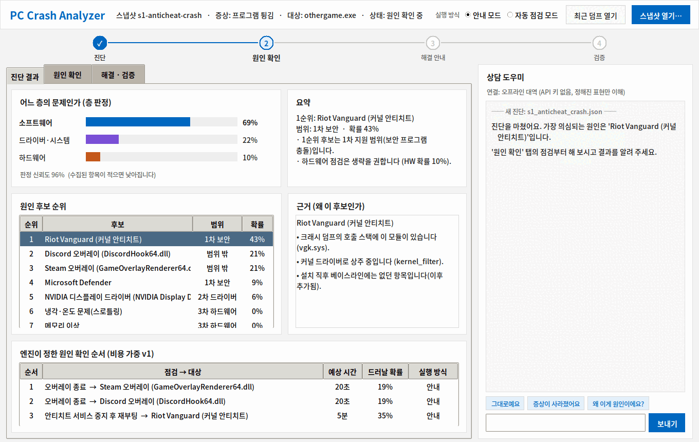

# PC Crash Analyzer

> 사용자 PC에서 발생하는 크래시·오작동의 원인을 증거 기반으로 추론하고, **무엇을 먼저 확인해야 하는지** 순서를 안내하는 Windows용 진단 도구

<!-- 스크린샷 자리: 진단 결과 화면 캡처를 docs/images/ 에 넣고 아래 주석을 해제하세요 -->
<!--  -->

중앙대학교 소프트웨어학부 2026학년도 2학기 캡스톤디자인 (5분반 · 7조) 프로젝트입니다.

> **지금 상태 (2026-11-14)** — 팀원은 [`docs/capstone-plan-v2.md`](docs/capstone-plan-v2.md) 맨 위 "11/14 밤 결정"(목표·강조점·분담·일정)부터 읽는다.
> - 목표: 크래시·오작동·느려짐의 원인을 증거로 추론하고 무엇을 먼저 확인할지 안내하는, **설치해서 쓰는 제품**까지 만든다. 강조할 것은 AI 정확도 · 안정성 · 감시엔진(수집기) 성능 · 사용자가 자기 API 키로 쓰는 AI · 적은 메모리다. API 키는 제품에 넣지 않는다.
> - 평가: 가상 머신에서 원인을 아는 사례를 만들고(`lab/vm/`), 같은 사례를 여러 방식으로 AI 에 물어 채점한다(`eval/`, 설계와 지금까지의 숫자는 [`docs/evaluation-design-v3.md`](docs/evaluation-design-v3.md)). 넣은 문제 사례만으로는 엔진 단독으로도 만점이라, 11/14 부터 **실제 프로그램의 알려진 버그·사용자가 돌린 무거운 작업·Windows 자체 작업**을 사례로 만든다(분야별 조사: [`docs/real-case-survey.md`](docs/real-case-survey.md)).
> - 아직 없는 것: 제품 안의 AI 호출(C#), 조치 실행기(11/02 보관본 복원 전), 위험 등급. 수집기 메모리는 게스트 38~80MB·호스트 94~114MB 로 "적다"고 하기에는 크다(`collector/NOTES.md` 11/14).
>
> **이전 상태 (2026-11-12)**
> - 수집기·엔진·UI(WPF)가 한 흐름으로 이어져 있다: 크래시 → 자동 덤프 → 진단 → 안내.
> - 연구 참여자용 트레이 앱 **PC 블랙박스 0.9.0**에 자동 업데이트를 넣었다. 업데이트 파일은 [Releases](../../releases)로 내보낸다(초대받은 참여자용 — 아래 「참여자판」 참고).
> - 11/10에 목표를 넓혔다: 보안·상주 프로그램의 충돌·느려짐을 증거로 판단하고, 사용자가 정한 수준 안에서 조치까지 한다. 원인이 보안 프로그램이 아니어도 원인 프로그램을 찾는다. 로그를 읽고 해석하기 어려운 사용자(사무직, 영업직, 디자이너, 모델러 등)를 대신해 흩어진 증거를 모으고 AI에 정확히 전달하는 것이 핵심이다. 위험도 점수·지식 팩·AI 보조·조치 실행기는 **설계 단계**다 — [`docs/capstone-plan-v2.md`](docs/capstone-plan-v2.md), [`docs/product-architecture-v2.md`](docs/product-architecture-v2.md).
> - 사례는 가상 머신에서 만든다: 프로그램을 여러 개 설치한 PC, 메모리가 모자란 사무용 PC 등을 복제본으로 만들고 문제를 재현해 원인을 아는 사례(골드셋)를 쌓는다. 호스트에서의 설치 전·후 영향 측정은 11/12에 중단했다 — [`lab/README.md`](lab/README.md).
>
> 자세한 내용은 아래 [진행 상황](#진행-상황).

---

## 문제

게임이 튕기고, 화면이 깜빡이고, 프레임이 떨어진다. 원인이 백신 때문인지, 드라이버 때문인지, 온도 때문인지 모르는 채로 사용자는 프로그램을 하나씩 끄고, 드라이버를 다시 깔고, 부품을 뽑았다 꽂는 시행착오를 반복한다.

크래시의 원인은 세 층에 걸쳐 있고, 증상만 보면 서로 구분되지 않는다.

| 층 | 대표 원인 | 증상 |
|---|---|---|
| 소프트웨어 충돌 | 백신·안티치트·금융 보안모듈·오버레이·입력장치 유틸의 후킹·DLL 삽입, 보안 방화벽 간섭 | 특정 프로그램만 튕김, 입력 누락, 접속 불가 |
| 드라이버·시스템 | GPU·모니터·주변기기 드라이버와 유틸의 버전 문제, 업데이트 이후 회귀 | 화면 깜빡임, 프레임 튐, 특정 업데이트 이후 발생 |
| 하드웨어·물리 | 온도, 전원, 케이블 접촉, 부품 장착, 저장장치 이상 | 무관한 여러 프로그램에서 무작위 크래시, 예고 없는 재부팅 |

이 프로젝트는 그중 **보안 소프트웨어(백신·안티치트·금융 보안모듈·보안 방화벽)가 일으키는 충돌**을 중점적으로 다룬다. 시스템 깊이 개입해 충돌의 주요 원인이 되면서도, 함부로 삭제하면 보안 공백이 생기기 때문에 정확한 진단이 가장 필요한 영역이다.

## 접근

Python·CUDA 생태계에는 Env-Doctor, pipdeptree처럼 버전 충돌을 진단하는 도구가 있다. 패키지가 호환 조건을 메타데이터로 **선언**하기 때문이다. 일반 PC 소프트웨어는 아무것도 선언하지 않는다. 대조할 명세가 없으므로, 우리는 **행동 증거**로부터 추론한다.

- **시간 상관** — 문제가 시작된 시점과 그 직전의 변화(설치·업데이트·설정)의 관계
- **공존 상관** — 문제 순간 대상 프로세스에 로드된 모듈·훅·드라이버, 시스템 상태(온도·전력·연결)
- 집단 통계 — 같은 조합에서 같은 증상이 다른 PC에도 나는가 (이번 학기는 구조만 설계)

결과는 하나의 처방이 아니라 **확률적 순위와 신뢰도**로 나오고, 사용자의 시도와 피드백으로 갱신된다.

## 기존 백신·PC 최적화 프로그램과 다른 점

대상은 로그를 읽고 상황을 해석하기 어려운 사용자(사무직, 영업직, 디자이너, 모델러 등)다. 백신을 대체하지 않는다(악성코드 탐지가 아니다).

| | 기존 도구 | 이 도구 | 지금 |
|---|---|---|---|
| 근본 원인 | 임시 파일·메모리·시작 프로그램을 일괄 정리. 무엇이 원인인지 말하지 않음 | 사건 순간의 증거로 원인 프로그램을 지목하고 그 원인에 맞는 조치를 제시 | 엔진 동작, 정확도 평가 전 |
| 버전·드라이버 문제 | 대상이 아니거나 "최신으로"만 권함 | 알려진 버그 버전 → 수정 버전·우회 설정, 업데이트 뒤 생긴 문제 → 되돌리기 안내 | 설계 |
| PC에 익숙하지 않은 사용자 | 로그와 용어를 사용자가 해석해야 함 | 증거를 대신 모으고 쉬운 말로 설명, 확인 순서를 안내 | UI 있음 |
| LLM 활용 | 없음, 또는 증상 설명만으로 일반 조언 | 이 PC의 증거와 알고리즘 결과를 전달. 근거 인용 필수, 실행 권한 없음 | 설계 |
| 비용 | — | 증거를 추려 보내 LLM 토큰을 줄임 | 측정 전 |
| 커스텀 | 고정된 정책 | 위험도 가중치, 조치 수준, 지식 팩을 조정 | 설계 |

도구 자체가 부담이 되지 않게 만든다: 상시 수집의 CPU 사용은 0.13%(테스트 PC 1대 실측)이고, 커널 드라이버나 항상 떠 있는 관리자 서비스를 두지 않는다.

## 아키텍처

```
┌──────────────────────────────────────────────────────────────┐
│  블랙박스 수집기 (collector)                                    │
│  ETW 구독 우선 · 폴링 폴백 · 메모리 링버퍼(저장 안 함)              │
│  프로세스·모듈 변화 / 이벤트 로그 / 센서 / 설치·설정 변경             │
└───────────────┬──────────────────────────────────────────────┘
                │  단축키 마킹 또는 자동 감지
                │  (이벤트 1000/1001 · 41 · 4101 · 프레임타임 급락)
                ▼
┌──────────────────────────────────────────────────────────────┐
│  스냅샷 덤프 (마킹 전후 + 트리거 이벤트만)                          │
└───────────────┬──────────────────────────────────────────────┘
                ▼
┌──────────────────────────────────────────────────────────────┐
│  추론 엔진 (engine)                                            │
│  ① 층 판정 → ② 후보 점수화 → ③ 시도 순서 최적화 → ④ 피드백 학습    │
│                         ▲                                    │
│              사례 DB (knowledge)                               │
└───────────────┬──────────────────────────────────────────────┘
                ▼
┌──────────────────────────────────────────────────────────────┐
│  안내 UI (ui)                                                  │
│  층 판정 · 후보 순위 · 근거 그래프 · 점검 순서 · 피드백 버튼          │
└──────────────────────────────────────────────────────────────┘
```

### 검사 방식

| 방식 | 역할 | 설명 |
|---|---|---|
| 블랙박스 상시 수집 + 마킹 | 기본 | 최근 수 분만 메모리에 유지. 마킹 시 전후 스냅샷과 트리거 이벤트만 덤프 |
| 재현 모드 | 심층 | '재현 시도' 시작 → 고밀도 캡처 → '발생' 버튼 |
| 사후 스냅샷 | 폴백 | 설치 전 문제도 이벤트 로그·설치 이력으로 최소 진단 |
| 확인 단계 | 검증 | "1번 후보를 일시 정지하고 다시 해보세요" → 결과 피드백 |

세 가지 원칙: 실시간 **분석**은 하지 않고 **수집**만 한다 · 전체 로그를 해석하지 않고 후보를 먼저 선별한다 · 자동 마킹은 제안이고 확정은 사용자가 한다.

## 지원 증상과 원인 층

**증상**: 프로그램 비정상 종료 · 프리징 · 프레임 저하 · 화면 깜빡임/끊김 · 입력 누락 · 실행 불가 · 네트워크 접속 불가/끊김 · 예고 없는 재부팅

**수집 신호**

| 층 | 신호 | 확인 방법 |
|---|---|---|
| SW | 프로세스에 로드된 외부 DLL, 키보드·마우스 클래스 UpperFilters, 커널 필터 드라이버, 백신 중복, 방화벽 차단 기록, NDIS 네트워크 필터 | 모듈·서비스 열거, 레지스트리, 방화벽 로그, WER LocalDumps 미니덤프 |
| 드라이버 | 크래시 이벤트 1000/1001과 오류 모듈, 디스플레이 이벤트 4101, 최근 설치·업데이트·설정 변경 | 이벤트 로그, 안정성 모니터, 설치 시점 베이스라인과의 diff |
| HW | 온도·클럭·스로틀링, Kernel-Power 41, WHEA 오류, GPU 전력 제한, PCIe 링크 폭, 모니터·USB 연결 끊김 반복, SMART | LibreHardwareMonitor, PresentMon, 이벤트 로그 |

하드웨어는 직접 측정할 수 없으므로 OS·센서에 남는 흔적으로 '하드웨어 의심' 등급까지 판정하고 물리 점검 순서를 안내한다.

**하지 않는 것**: 사용자가 고르지 않은 자동 조치(프로그램 종료·삭제·설정 변경) · 보안모듈 내부 분석 · 패킷 내용 검사 · 키 입력 내용 수집 · macOS/Linux

수집기는 읽기 전용이고 조치를 하지 않는다. 조치는 사용자가 고른 수준 안에서만 별도 실행기가 맡는 것으로 설계했다(관찰 → 일시 조치 → 설정 변경 → 시스템 변경, 단계가 올라갈수록 동의·승인이 필요하고 실행 전 원복 지점을 남김). 실행기는 아직 실제 Windows에서 돌려 보지 않았다.

## 빌드 · 실행

### 추론 엔진 (`engine/`)

요구 사항: Windows 10/11 (x64), Visual Studio 2022(「C++를 사용한 데스크톱 개발」, CMake 포함). 외부 라이브러리 없음.

"Developer Command Prompt for VS 2022"에서:

```
cd engine
cmake -S . -B build
cmake --build build --config Release
ctest --test-dir build -C Release --output-on-failure

build\Release\crash_engine.exe diagnose data\samples\s1_anticheat_crash.json
```

진단 세션(원인 확인 → 해결 안내 → 검증) 실행 방법은 [`engine/docs/scenario_walkthrough.md`](engine/docs/scenario_walkthrough.md) 참고.

### 수집기 (`collector/`)

요구 사항: .NET 8 SDK(8.0 런타임 포함). 팀 PC 준비는 [`docs/setup.md`](docs/setup.md).

```powershell
dotnet build collector/BlackBox -c Release
dotnet test  collector/BlackBox.Tests -c Release

cd collector/BlackBox
dotnet run -c Release          # m+Enter = 수동 마킹, Ctrl+Shift+F12 = 전역 단축키, q = 종료
```

- 프로그램 비정상 종료(이벤트 1000/1001)·응답 없음(1002)·전원 이상(41)·디스플레이 드라이버 재시작(4101)·WHEA는 자동으로 마킹된다.
- 마킹되면 `dumps/<시각>-<종류>/`에 전후 구간만 JSON으로 쓴다. 그 안의 `engine-snapshot.json`이 엔진 입력이다.

```
engine\build\Release\crash_engine.exe diagnose dumps\<폴더>\engine-snapshot.json
```

- 관리자 터미널을 권장한다(커널 ETW, 필터 드라이버 목록, 접근이 막힌 프로세스의 모듈). 관리자가 아니어도 동작하고, 못 모은 항목은 `unavailable`과 이유로 기록한다.
- 전체 흐름: [`docs/run-pipeline.md`](docs/run-pipeline.md) · 신호별 상태: [`docs/collector-status.md`](docs/collector-status.md), [`collector/NOTES.md`](collector/NOTES.md)

### 안내 UI (`ui/wpf/`)

엔진을 빌드한 뒤 `ui\wpf\run_ui.bat`을 더블클릭한다(처음이면 자동으로 빌드, .NET 8 SDK 필요). 자세한 내용은 [`ui/wpf/CrashAnalyzer.UI/README.md`](ui/wpf/CrashAnalyzer.UI/README.md).

### 참여자판 — PC 블랙박스 (`participant/`)

연구 참여자 PC에서 수집기를 트레이 앱으로 돌리고, 기록을 암호화해 팀에 자동으로 보내는 판이다. 수집 코드는 `collector/`의 것을 그대로 쓴다.

- **참여는 팀이 초대한 분만 받는다.** 참여자는 팀이 직접 건넨 zip으로 설치한다. 사용법은 [`docs/participant-guide.md`](docs/participant-guide.md).
- **[Releases](../../releases)의 파일은 이미 설치한 참여자의 자동 업데이트용**이다(0.9.0부터). 연구 참여 설정이 들어 있지 않아서 그 파일만 받아서는 실행되지 않는다.
- 업데이트는 알림을 보고 사용자가 눌러야 적용된다. 앱은 팀 서명(ECDSA P-256)과 SHA-256을 확인한 뒤에만 바꾸고, 새 버전이 켜지지 않으면 이전 버전으로 되돌린다.
- 연구 설정 없이 누구나 로컬에서만 쓰는 공개판은 아직 없다(UI를 합칠 때 만들 예정).
- 팀용 운영 절차(키, 수신기, 배포·업데이트 내보내기, 보안 모델): [`docs/study-operations.md`](docs/study-operations.md)

## 프라이버시

- 설치 및 첫 실행 시 **수집 항목과 보관 위치를 고지하고 명시적 동의**를 받은 뒤에만 수집을 시작한다.
- **콘솔 수집기·엔진·UI는 모든 데이터를 로컬에만 저장**하며 어디로도 전송하지 않는다. 언제든 수집 중지와 데이터 삭제가 가능하다.
- **참여자판(PC 블랙박스)은 예외다.** 연구 참여에 동의한 사람의 기록만, 참여자 PC에서 암호화한 뒤(AES-256-GCM + RSA-OAEP) 팀 수신기로 보낸다. 수신기와 저장소는 내용을 열 수 없고, 개인키를 가진 팀 PC에서만 풀린다. 참여자는 언제든 철회할 수 있다. 0.9.0부터는 새 버전이 있는지 보려고 github.com의 이 저장소 Releases에 접속한다(확인용 파일을 받기만 하고 기록을 보내지 않음).
- 마킹 전에는 디스크에 아무것도 쓰지 않는다(메모리 링버퍼). 덤프를 쓸 때 사용자 폴더 경로는 `%USERPROFILE%`로 바꾼다.
- 기록을 AI 서비스로 보내는 기능은 아직 없다. 넣을 때는 동의문에 항목을 추가한 뒤에만 참여자에게 적용한다.
- 크래시 미니덤프에는 프로그램 메모리 일부가 포함될 수 있음을 고지하고, 분석에 필요한 모듈·스택 정보만 추출한 뒤 원본은 사용자 선택에 따라 삭제한다.
- 네트워크 관련 신호는 방화벽 로그·필터 목록 등 설정과 로그로 한정한다. 패킷 내용은 열람하지 않는다.

## 검증 방법

**제어된 실험 (알고리즘 검증용)** — 더미 애플리케이션과, 결정적으로 크래시·입력 지연·프레임 저하를 유발하는 더미 훅 DLL·오버레이·필터를 조합한 fault injection 환경. 원인이 사전에 확정되어 있어 깨끗한 측정이 가능하다. 더미 필터 드라이버는 테스트 서명이 필요하므로 VM에서만 사용한다.

**실제 사례 (시연·사례 DB용)** — VM과 실기에 실제 백신·보안모듈·유틸리티 조합을 설치해 재현. 재현 실패 사례는 '미검증'으로 관리한다.

| 지표 | 정의 |
|---|---|
| 층 판정 정확도 | SW / 드라이버 / HW를 올바르게 판정한 비율 |
| 원인 정확도 | Top-1 / Top-3 안에 실제 원인이 포함된 비율. 정답 라벨은 실험 전 고정 |
| 시도 횟수·비용 감소율 | 커뮤니티 표준 체크리스트 순서 대비 본 도구 순서 |
| 수집 오버헤드 | 상시 수집기의 CPU·메모리 점유 |
| 사용성 | 비전공자 대상 SUS |

**보안 프로그램 영향 측정 (11/10 추가)** — 금융 보안 프로그램을 설치하기 전과 후에 같은 작업(Blender·Godot·Notepad++의 시작·작업·반응)을 재부팅을 끼워 가며 무인으로 반복 측정한다. 설계는 [`docs/security-impact-design.md`](docs/security-impact-design.md), 실행 스크립트는 [`lab/`](lab/). 평가 전체 설계(위험도 점수 타당성, 알고리즘·AI 비교, 조치 검증)는 [`docs/capstone-plan-v2.md`](docs/capstone-plan-v2.md) 4절.

fault injection 프로그램(CrashDummy, FaultLab)과 측정 스크립트는 [`collector/experiments/`](collector/experiments/)에, 엔진 규칙과 시나리오는 [`engine/data/`](engine/data/)에 있다.

## 저장소 구조

```
collector/     블랙박스 수집기 (ETW·이벤트 로그·센서·마킹·덤프), 테스트, 실험용 프로그램(experiments/)
participant/   참여자판 PC 블랙박스(트레이 앱)·암호화 자동 전송·자동 업데이트·팀 도구 — docs/study-operations.md
engine/        추론 엔진 (층 판정·점수화·시도 순서·피드백), 규칙·시나리오(data/)
ui/            안내 UI (C# WPF)
lab/           보안 프로그램 영향 측정 — 무인 세션·블록 실행·분석 (lab/README.md)
tools/         배포·릴리스·시험 스크립트 (참여자판 빌드, 업데이트 시험, 오버헤드 측정 등)
docs/          설계·조사·운영 문서, 참여자 안내, 발표 준비 자료
```

## 일정

| 주차 | 목표 |
|---|---|
| ~10/9 | 수집기 MVP, 센서·덤프 연동, 사례 DB 스키마, fault injection 초안 |
| 10/16 | **중간 발표** — 엔진 v0(단순 가중합), 제어 실험 1차 측정 |
| ~11/13 | 엔진 v1(비용 가중 그룹 테스팅), 실제 사례 20~30건, 근거 그래프 UI |
| ~11/27 | 검증 실험, 사용성 테스트, 재현 모드, UI 완성 |
| 12/11 | **최종 데모** |

위 표는 학기 초 계획이다. 11/10에 목표를 다시 정하면서 남은 기간(11/10 → 12/11)의 주별 계획을 새로 짰다 — [`docs/capstone-plan-v2.md`](docs/capstone-plan-v2.md) 6절.

진행 상황은 [Milestones](../../milestones)와 [Projects](../../projects)에서 확인할 수 있다.

## 진행 상황

### 수집기 · 참여자판 · 측정 실험 (2026-11-12 기준)

모든 수치는 **테스트 PC 1대에서 잰 값**이다. 다른 PC에서는 다를 수 있다.

| 부분 | 상태 | 확인된 것 |
|---|---|---|
| 수집기 | 동작 | 합성 크래시 자동 감지 9/9, 30분 가동 CPU 평균 0.13%(머신 전체) — [`docs/collector-status.md`](docs/collector-status.md). 단위 테스트 84건 통과 |
| 수집기 → 엔진 → UI | 연결됨 | 덤프의 `engine-snapshot.json`을 엔진이 바로 진단, UI가 엔진 결과를 표시 |
| 참여자판 0.9.0 | 배포 준비 | 동의 → 상시 수집 → 암호화 자동 전송, 관리자 권한 자동 실행, 자동 업데이트. 단위 테스트 90건 통과 |
| 자동 업데이트 | 시험 환경에서 확인 | 표준 사용자·관리자 경로 각각 28개 확인 통과: 받기·서명 확인·교체·재시작, 낮은 버전 무시, 실패 시 되돌리기, 고친 안내문·바뀐 묶음 거부 |
| 원인 엔진 | 팀 시나리오에서는 강함, 실제 사례에서는 약함 | 팀 시나리오 13건: 층 100%·원인 1순위 92% / 외부 라벨 18건: 50%·17%(탐색용) |
| 재현 사례 | 9건 | AutoHotkey 2.0.29, Godot 4.3, Notepad++ 8.6.7의 알려진 버그를 이 PC에서 재현해 덤프 확보 |
| 가상 머신 사례 생산 | 준비 중 | 원본·복제본·체크포인트·PC 형태 프로필·GPU 분할 스크립트 동작(OS 없이 확인). Windows 설치 중. 호스트의 설치 전·후 영향 측정은 11/12 중단 |
| 위험도 점수 · 지식 팩 · AI 보조 · 조치 실행기 | 설계 단계 | 구현·검증 전 |

**아직 확인하지 못한 것**

- 자동 업데이트: 실제 설치 위치(`C:\Program Files\PcBlackBox`)에서의 교체, 설치된 앱이 GitHub Releases에서 받아 교체하는 것. 릴리스 `v0.9.0`에 올린 파일이 빌드한 것과 같고 앱의 검사를 통과하는 것까지는 확인했다(11/12). 0.9.0이 첫 버전이라 실제 교체는 다음 버전에서 처음 일어난다.
- 참여자 데이터: 11월 초 팀 PC 포맷으로 이전 암호 키를 잃어 그전에 받은 기록은 열 수 없다. 발표의 핵심 숫자에는 참여자 데이터를 쓰지 않는다.
- 엔진의 "공식 근거가 있는 충돌 사례" 정확도: 해당 사례가 아직 0건이다. 재현한 9건은 모두 프로그램 자체 버그다.
- 가상 머신: 실제 Windows 게스트에서의 실행·GPU 동작·보안 모듈 동작은 아직 확인 전이다. 병원·공장의 전용 프로그램은 구할 수 없어 대역으로만 보인다.

신호별 검증 상태(검증됨 / 미지원 / 권한 필요 / 미확인)는 [`collector/NOTES.md`](collector/NOTES.md)에 계속 적는다.

### 추론 엔진 (`engine/`) — 1차 구현 완료 (2026-10-02 기준)

멘토링 1차(9/27) 결과를 반영해 엔진을 다시 구현했다. 자세한 내용은 [`engine/README.md`](engine/README.md) 참고.

| 항목 | 상태 |
|---|---|
| 층 판정 · 후보 점수화 · 시도 순서(v0/v1) · 피드백 학습 | 완료 |
| 1차 범위: 보안 프로그램 충돌(안티치트·백신·금융 보안모듈·보안 방화벽) | 완료 |
| 세션: 증상 → 원인 확인 → 해결 안내 → 해결 검증 | 완료 (안티치트 시나리오로 끝까지 동작) |
| LLM 에이전트용 도구 인터페이스(JSON, 7종) | 완료 — [`engine/docs/tool_api.md`](engine/docs/tool_api.md) |
| 안내 모드(기본) / 자동 점검 모드(선택) 판단 | 완료 — 실제 조치 실행기는 미정 |
| 수집기 MVP 신호(이벤트 1000/1001·UpperFilters·로드된 DLL·센서 가용 여부)만으로 진단 | 시나리오 1건으로 확인 |

**동작 확인 결과** (팀이 만든 실험용 시나리오 6건, 그중 보안 프로그램 4건)

| 지표 | 결과 |
|---|---|
| 층 판정 | 6건 모두 정답 |
| 원인 1순위 | 6건 모두 정답 |

| 점검 순서 | 평균 누적 시간 | 평균 기대 시간 |
|---|---|---|
| 커뮤니티 표준 순서 | 103.7분 | 54.5분 |
| 엔진 v0 (확률 순) | 13.5분 | 20.5분 |
| 엔진 v1 (비용 가중) | 14.6분 | 20.4분 |

* 시나리오를 엔진 개발 쪽에서 만들었고 6건뿐이라, 위 결과는 **정확도가 아니라 동작 확인**이다. 정확도는 실제 사례 20~30건으로 따로 측정한다(제안서 4.2).
* 누적 시간은 "점검하면 원인이 반드시 드러난다(점검 신뢰도 1)"고 가정하고 정답에 닿을 때까지 더한 값이다.
* 점검 비용이 팀 추정치라 소수점 아래 차이는 의미가 없다. 비교는 큰 차이(표준 순서 대비 엔진)만 본다.
* 6건 모두 1순위가 정답이라 1순위부터 확인하는 v0의 누적 시간이 더 짧게 나왔다. v1은 1순위가 틀릴 가능성까지 고려해 기대 시간을 줄이는 방식이며, 현재 두 방식의 기대 시간 차이는 거의 없다.
* 테스트 102건 통과, Windows(Visual Studio 2022) 빌드 확인
* 시연 절차: [`engine/docs/scenario_walkthrough.md`](engine/docs/scenario_walkthrough.md)

### 추론 엔진 (`engine/`) — 2차·3차 범위 추가 (2026-10-06)

멘토링 1차 3.3 의 확장 순서대로 2차 드라이버·시스템, 3차 하드웨어를 추가했다. 1차와 같은 흐름(원인 확인 → 해결 안내 → 검증)으로 동작한다.

| 추가한 항목 | 상태 |
|---|---|
| 2차 범위: 드라이버·시스템(GPU·모니터 유틸·랜카드 드라이버, 블루스크린) | 추가 (시나리오 3건) |
| 3차 범위: 하드웨어(냉각·전원·메모리·저장장치) | 추가 (시나리오 4건) |
| 새 신호: 블루스크린 덤프, 전원 손실, WHEA 부품, SMART, 랜 링크 끊김 | 추가 — 스냅샷 스키마 v1.2 |
| 빠른 확인 점검 5종(드라이버 롤백·팬 속도·전력 제한·XMP·랜카드 절전) | 추가 |
| 원인 신호(스로틀링·WHEA·4101 등)로 해결 검증 | 추가 (GPU 드라이버·과열 시나리오로 끝까지 동작) |
| 시도 순서 v1 계산 수정 | 수정 — 아래 참고 |

**동작 확인 결과** (실험용 시나리오 11건: 1차 4 / 2차 3 / 3차 4)

| 지표 | 결과 |
|---|---|
| 층 판정 | 11건 모두 정답 |
| 원인 1순위 | 11건 모두 정답 |

| 점검 순서 (11건 평균) | 평균 누적 시간 | 평균 기대 총비용 |
|---|---|---|
| 커뮤니티 표준 순서 | 139.3분 | 156.1분 |
| 엔진 v0 (확률 순) | 7.0분 | 41.8분 |
| 엔진 v1 (비용 가중) | 7.2분 | 35.2분 |

* v1 계산 수정: 순서를 고르는 계산과 기대 시간을 재는 계산의 가정이 달랐고, 원인을 못 찾은 경우를 0분으로 세고 있었다. 하드웨어 점검(30~90분)이 들어오자 v1이 v0보다 길게 나와 발견했다. 두 계산의 가정을 맞추고, 못 찾은 경우를 120분(수리점·전문가에게 맡기는 비용, 팀 추정)으로 센다.
* 그래서 위 표의 **기대 총비용**은 1차 표의 '평균 기대 시간'과 계산 방식이 달라 직접 비교하지 않는다.
* 11건 모두에서 v1이 v0보다 같거나 작다(비싼 점검이 섞인 2·3차에서 차이가 큼). 누적 시간은 1순위가 모두 정답이라 v0가 조금 짧다.
* 여전히 **정확도가 아니라 동작 확인**이고, 점검 비용·신뢰도·120분은 팀 추정치다.
* 테스트 144건 통과(gcc·clang). Windows(Visual Studio 2022) 빌드는 다시 확인 예정
* 시연 절차에 2차 GPU 드라이버 예시 추가: [`engine/docs/scenario_walkthrough.md`](engine/docs/scenario_walkthrough.md)

### 안내 UI (`ui/`) · 에이전트 연결 — Python 시안 추가 (2026-10-12)

엔진 결과를 진단 → 원인 확인 → 해결 안내 → 검증 순서로 보여 주는 Windows 데스크톱 화면과, 엔진을 도구로 부르는 LLM 에이전트 연결을 추가했다.
UI·에이전트는 판단하지 않고 엔진이 돌려준 값만 보여 주고 설명한다(멘토링 1차 3.1 역할 분리).
**최종 UI 는 수집기와 같은 C#(.NET 8) WPF 로 만들기로 했다.** 이번에 올린 Python 버전(`ui/prototype-python/`)은 C# 버전이 따라잡을 때까지 쓰는 시연·비교용 시안이다.

| 추가한 항목 | 상태 |
|---|---|
| 데스크톱 UI 시안 (파이썬 표준 tkinter) — 진단 결과 / 원인 확인 / 해결·검증 탭 | 추가 (시안) |
| 최종 UI: C# WPF (`ui/wpf/`) | 작업 예정 |
| 상담 창: LLM 에이전트(Claude API tool use). API 키가 없으면 오프라인 대역(정해진 표현만 이해) | 추가 — 실제 API 호출은 미확인 |
| 수집기 덤프 연동: [최근 덤프 열기], 증상이 비어 있으면 사용자에게 묻는 창 | 추가 (수집기 덤프 형식으로 확인) |
| 자동 점검 모드 | 표시만 — 실제 조치 실행기는 미정 |



* 화면 캡처는 실험용 시나리오(s1·s7)로 만든 것이다. 나머지 화면: [`ui/prototype-python/README.md`](ui/prototype-python/README.md)
* 리눅스에서 실행해 흐름(진단 → 점검 → 원인 확정 → 해결책 적용 → 사후 스냅샷 검증)을 확인했다. Windows 실행 확인 예정

## 팀

**7조** — 중앙대학교 소프트웨어학부 캡스톤디자인 2026-2 (5분반) · 지도교수: 이준우 교수님

| 이름 | 역할 |
|---|---|
| 정태웅 | 블랙박스 수집기 — 상시 수집·마킹·덤프, 센서·이벤트 |
| 송민석 | 추론 엔진 — 층 판정, 점수화, 시도 순서 |
| 남건호 | 사례 DB·실험 — fault injection, VM 재현, 측정 |
| 정태웅/송민석 | UI·통합·문서 — 안내 UI, 통합, 보고서 |

## 기여 방법

- `main`은 보호되어 있습니다. `feat/<영역>` 브랜치에서 작업하고 PR로 병합합니다.
- 커밋 메시지는 `영역: 무엇을` 형식을 씁니다. 예: `engine: v0 가중합 구현`
- 크래시 덤프(`*.dmp`), 트레이스(`*.etl`), 로그는 커밋하지 않습니다. `.gitignore`에 포함되어 있습니다.

## 사용 라이브러리 · 참고

| 이름 | 용도 | 라이선스 |
|---|---|---|
| [LibreHardwareMonitor](https://github.com/LibreHardwareMonitor/LibreHardwareMonitor) | 온도·클럭·전력 센서 | MPL 2.0 |
| [Microsoft.Diagnostics.Tracing.TraceEvent](https://github.com/microsoft/perfview) | 커널 ETW (프로그램 시작·종료, DLL 로드) | MIT |
| [Intel PresentMon](https://github.com/GameTechDev/PresentMon) | 프레임타임 수집 | MIT |

참고한 기존 도구: [NVCheckup](https://github.com/thatcooperguy/NVCheckup), [Env-Doctor](https://pypi.org/project/env-doctor), [pipdeptree](https://github.com/tox-dev/pipdeptree), WhoCrashed, 구라제거기, Windows 문제 해결사

### 안내 UI — 최종 UI(WPF)로 정리 (2026-11-02 추가)

* UI 를 팀에서 확정한 시안 **2-4**(검진 결과 / 블랙박스 기록 페이지, 버튼으로 여는 상담 도우미 챗봇 창)로 바꿨다. 최종 UI 는 `ui/wpf/` (C# WPF) 하나다.
* 파이썬 시안(`ui/prototype-python/`)은 WPF 가 기능을 다 따라잡아서 폴더째(코드·README) 지웠다. 위 2026-10-12 단락은 그때 기준으로 그대로 둔다(`run_ui.bat`·`ui/prototype-python/README.md` 링크는 이제 없음). 지운 파일은 저장소 기록(2026-11-02 커밋 이전)에서 볼 수 있다.
* 실행: 엔진을 빌드한 뒤 `ui\wpf\run_ui.bat` 을 더블클릭한다(처음이면 자동으로 빌드, .NET 8 SDK 필요). 자세한 내용은 [`ui/wpf/CrashAnalyzer.UI/README.md`](ui/wpf/CrashAnalyzer.UI/README.md).

## 라이선스

[MIT](LICENSE)
