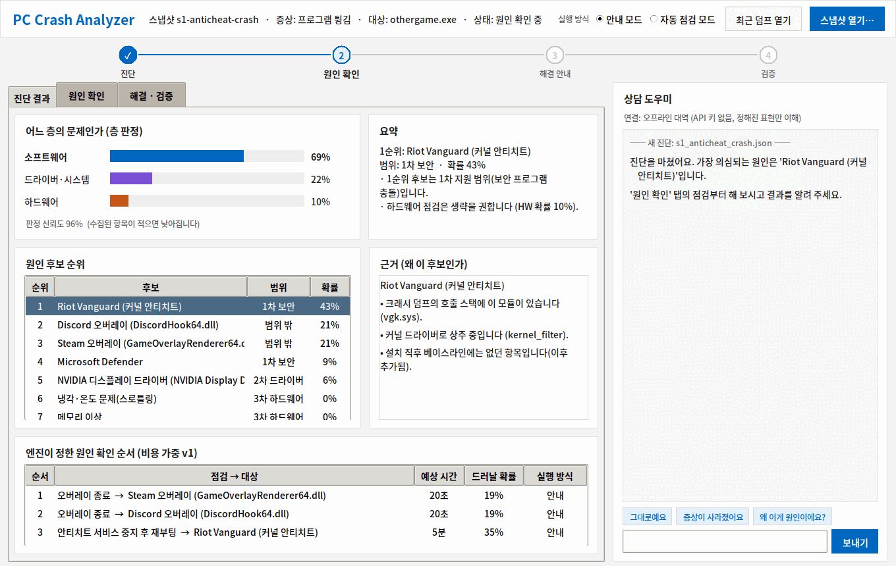
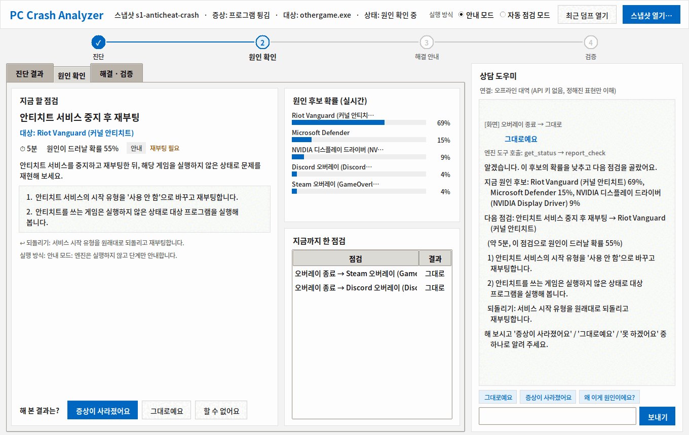
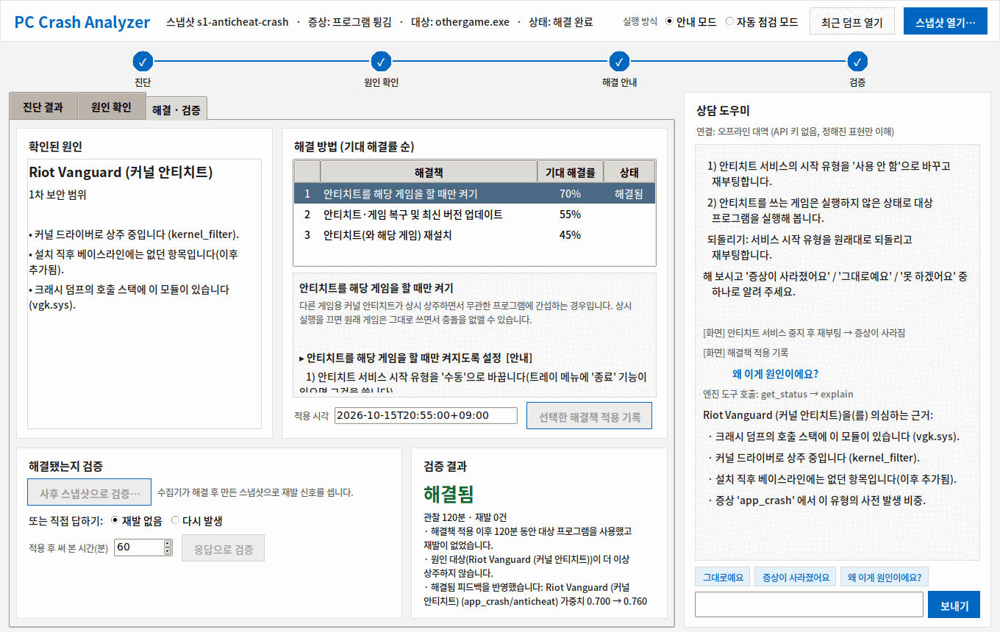
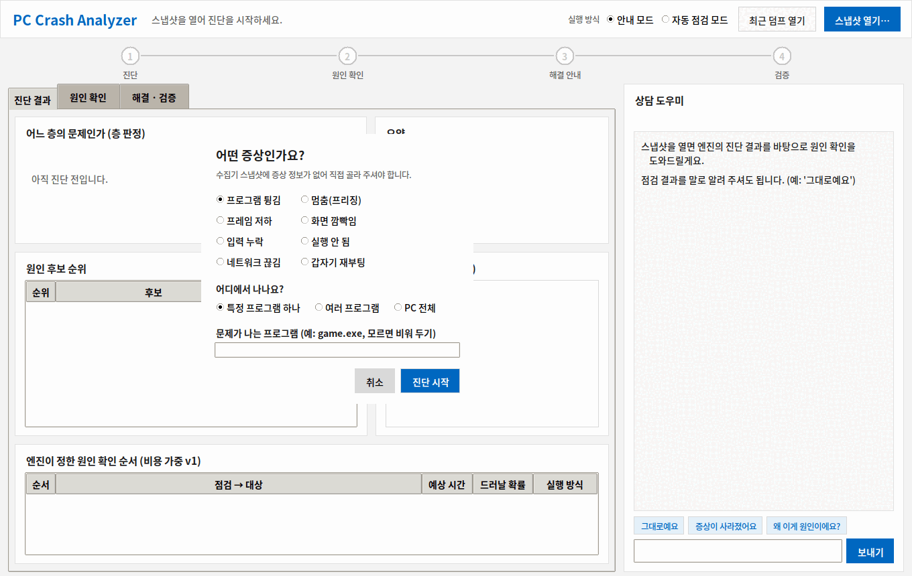

# ui/prototype-python — 안내형 UI Python 시안

PC Crash Analyzer 7조 / 송민석 — 초안 작성 2026-10-06, 저장소 추가 2026-10-12

> **이 폴더는 시안(prototype)이다.** 최종 UI 는 수집기(C# .NET 8)와 같은 **C# WPF** 로 만든다(2026-10-12 결정).
> C# 버전이 이 시안의 기능을 다 따라잡을 때까지 시연·비교용으로만 두고, 새 기능은 C# 버전에만 추가한 뒤 이 폴더는 지운다.

추론 엔진(`engine/`)의 결과를 **진단 → 원인 확인 → 해결 안내 → 검증** 순서로 보여 주는 Windows 데스크톱 화면이다.
파이썬 표준 `tkinter` 만 쓰므로 따로 설치할 라이브러리는 없다.

UI 는 판단하지 않는다. 층 판정·후보 확률·점검 순서·실행 방식은 모두 엔진(`crash_engine tool ...`)이 돌려준 값을 그대로 보여 준다.

## 실행

1. 엔진을 먼저 빌드한다 (`engine/README.md` 의 빌드 절차). UI 는 `engine/build/Release/crash_engine.exe` 를 자동으로 찾는다.
   다른 위치면 `set CE_ENGINE=C:\경로\crash_engine.exe`.
2. `ui\prototype-python\run_ui.bat` 을 더블클릭하면 콘솔 창 없이 바로 뜬다. (Python 3.10 이상 필요, python.org 설치본에는 tkinter 포함)
   명령줄에서 실행할 때:

```
python ui\prototype-python\crash_ui.py
python ui\prototype-python\crash_ui.py engine\data\samples\s1_anticheat_crash.json
```

## 화면

| 영역 | 내용 | 엔진 도구 |
|---|---|---|
| 머리글 | 스냅샷·증상·대상·상태, 안내/자동 점검 모드, [최근 덤프 열기], [스냅샷 열기] | — |
| 단계 표시 | ① 진단 ② 원인 확인 ③ 해결 안내 ④ 검증 (세션 상태로 표시) | `session_status` |
| 진단 결과 탭 | 층 판정 막대, 원인 후보 순위(범위 1·2·3차), 후보별 근거, 엔진이 정한 확인 순서 | `diagnose` |
| 원인 확인 탭 | 지금 할 점검 1개(단계·되돌리기·실행 방식), 결과 버튼, 후보 확률 변화, 지난 점검 | `session_report` |
| 해결 · 검증 탭 | 확인된 원인과 근거, 해결책(기대 해결률 순), 적용 기록, 사후 스냅샷/사용자 응답으로 검증 | `session_apply_fix`, `session_verify` |
| 상담 창 | LLM 에이전트와 대화. 말로 결과를 알려도 같은 세션에 반영 | `ce_agent.py` (같은 폴더, 아래 「상담 창(LLM 에이전트)」) |





## 수집기 덤프 바로 열기 (2026-10-12 추가)

* **[최근 덤프 열기]**: `collector` 폴더 아래에서 가장 최근의 `engine-snapshot.json`(수집기 덤프)을 찾아 연다.
  덤프가 다른 곳에 있으면 `set CE_DUMPS=C:\덤프\폴더`.
* **증상 선택 창**: 수집기 수동 마킹(단축키)은 증상이 `unknown` 으로 들어온다(`docs/run-pipeline.md`).
  이때 UI 가 증상 종류·범위·대상 프로그램을 묻고, 원본 덤프는 그대로 둔 채 채운 사본으로 진단한다.



## 알아 둘 점

* 세션 파일은 `%TEMP%\pc_crash_analyzer\session_날짜_시각.json` 에 저장된다. 스냅샷을 새로 열면 새 세션이다.
* **자동 점검 모드**는 지금은 '자동 가능 / 동의 후 실행 / 직접 작업' 표시만 바뀐다. 실제로 조치를 실행하는
  실행기는 아직 없다(정태웅 담당 「자동 점검 모드 허용 범위」가 정해진 뒤 연결).
* 상담 창은 `ANTHROPIC_API_KEY` 환경 변수가 있으면 Claude API, 없으면 오프라인 대역(정해진 표현만 이해)으로 동작한다.
* 화면 캡처는 `docs/images/ui_*.png` (실험용 시나리오 s1·s7 로 만든 것).

## 상담 창 (LLM 에이전트, `ce_agent.py`)

멘토링 1차 2.1 / 3.1 의 「추론은 팀이 만든 엔진, LLM 은 해석·설명·조율」 구조를 코드로 옮긴 것이다.
프레임워크(LangGraph / Google ADK) 선정은 정태웅 담당이므로, 여기서는 **프레임워크 없이** Claude API 의
tool use 로 최소 연결만 만들었다. 프레임워크가 정해지면 `AGENT_TOOLS` 와 `ToolRunner` 를 그대로 옮겨 쓰면 된다.

### 구조

```
사용자 말 ─▶ ClaudeAgent / OfflineAgent ─▶ ToolRunner ─▶ crash_engine tool <이름>
                     ▲                        (세션·스냅샷 경로는 여기서만 넣음)
                     └──────── 도구 결과(JSON) ◀───────┘
```

| LLM 에게 보이는 도구 | 실제 엔진 도구 | 언제 |
|---|---|---|
| `get_status` | `session_status` | 안내하기 전에 항상 |
| `report_check` | `session_report` | 사용자가 점검 결과를 분명히 말했을 때 |
| `explain` | `explain` | "왜 이게 원인이에요?" |
| `apply_fix` | `session_apply_fix` | 사용자가 해결책을 적용했다고 말했을 때 |
| `verify_with_answer` | `session_verify` | "2시간 동안 재발 없었어요" |

LLM 이 원인을 스스로 추측하지 못하게 하는 장치

1. 시스템 프롬프트: 원인·확률·순서·실행 방식은 도구 결과만 쓴다. 애매하면 되묻는다.
2. LLM 에게 파일 경로를 주지 않는다. `check_id`, `result` 같은 값만 고르게 한다.
3. 엔진이 잘못된 값을 거부하면(`없는 점검 id` 등) 그 오류를 `is_error` 로 LLM 에게 돌려준다.

### 실행

```
# API 키 없이 (오프라인 대역: '그대로예요', '사라졌어요', '왜요?', '적용했어요', '2시간 재발 없었어요' 를 이해)
python ui\prototype-python\ce_agent.py --session s.json --snapshot engine\data\samples\s1_anticheat_crash.json --offline

# Claude API
pip install anthropic
set ANTHROPIC_API_KEY=...
set CE_MODEL=claude-sonnet-5-5          (생략 시 이 값)
python ui\prototype-python\ce_agent.py --session s.json --snapshot engine\data\samples\s1_anticheat_crash.json
```

시안 UI(`crash_ui.py`)의 상담 창도 같은 코드를 쓴다.

### 아직 안 한 것

* LangGraph / ADK 로 옮기기 (프레임워크 선정 후)
* 사후 스냅샷 검증을 에이전트가 직접 요청하기 (수집기 연동 후)
* 대화 기록 저장, 개인정보 마스킹 규칙(도구 결과에 들어가는 프로세스·모듈 이름 범위 정하기)
